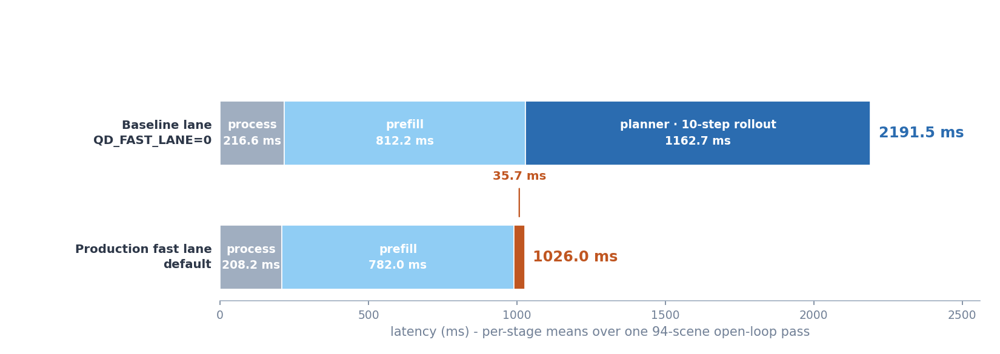
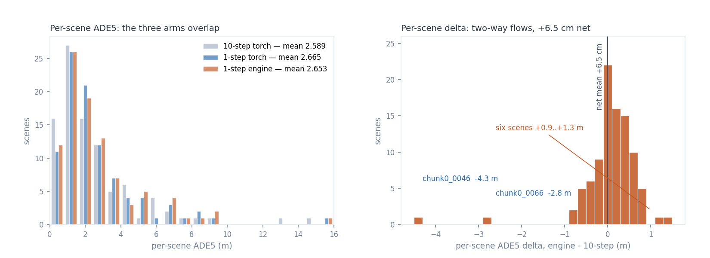
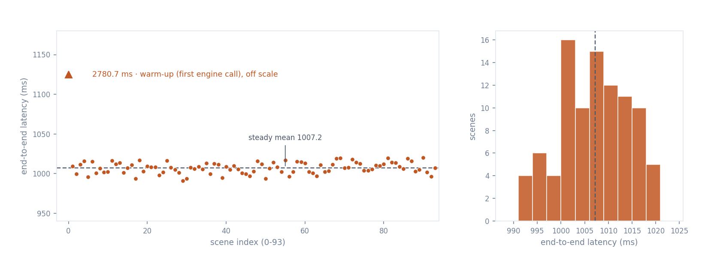

# qwen-drive-edge-orin

Edge deployment of [**Qwen-Drive-1.0-4B**](https://huggingface.co/Qwen/Qwen-Drive-1.0-4B) on Jetson AGX Orin: **1026 ms** end-to-end latency. Its 1-step trt planner at **35.7 ms** (33× faster than the 10-step rollout) with only **+2.48% ADE5(m)**.

## Open-loop replays

Six representative scenes from the 94-scene manifest, spanning the per-scene ADE5 distribution and day/night, straight/turn/lane-change conditions. Left panel: the three trajectories in bird's-eye view. Right panel: the same trajectories projected onto the front camera (f-theta fisheye model, per-scene calibration). The BEV marker tracks the recorded vehicle's actual position along the ground-truth path; the plans are anchored at the clip start and leave the camera frustum after ~2 s as the recorded vehicle advances — open-loop replay, not closed-loop driving.

<table>
  <tr>
    <td align="center"> suburban, straight · ADE5 0.57m</td>
    <td align="center"> signalized intersection, straight · ADE5 0.70m</td>
    <td align="center"> urban arterial, straight · ADE5 1.44m</td>
  </tr>
  <tr>
    <td align="center"> night intersection, straight · ADE5 1.73m</td>
    <td align="center"> intersection, right turn · ADE5 2.62m</td>
    <td align="center"> highway, lane change missed · ADE5 4.79m</td>
  </tr>
</table>

*ADE5 is the production 1-step engine arm against the recorded ground truth over the 5 s horizon, same metric definition as the Results table; the trajectory legend names match the arm names used throughout this README and docs/results.md. Predicted once at the clip start — open-loop protocol, no rolling replanning.*

## Results

All latencies: Jetson AGX Orin 64GB, MAXN, locked clocks, single stream, batch 1; means over one 94-scene open-loop pass (pre/post-processing included). The measurement-metadata block and the full evidence chain are in [docs/results.md](docs/results.md).

| Stage | Implementation | Latency |
|---|---|---|
| Process (tokenize + glue) | torch | 208.2 ms |
| Prefill (vision + text) | vision TRT fp16 engine + text torch bf16 eager | 782.0 ms |
| Planner | TRT bf16 one-step engine, dynamic-S | 35.7 ms |
| End to end | full chain | 1026.0 ms |

Text prefill runs eagerly in bf16 because the text and planner TRT engines cannot share one process (engine co-residency — [docs/results.md](docs/results.md), [docs/negative_results.md](docs/negative_results.md)).

Baseline on the same device (`QD_FAST_LANE=0`): the same chain with the planner run eagerly through its native 10-step sampler rollout — process 216.6 + prefill 812.2 + planner 1162.7 = 2191.5 ms end to end (the text engine's trt_text stage reads 580.5 ms of the prefill), with all gates PASS at 1.3076 cm.

*The plan stage is the whole story: the 10-step rollout costs 1.16 s of eager sampler calls; one engine call collapses it 33x.*

The planner serves every scene with one engine call (35.7 ms in-chain; 29.7 ms standalone p50 at S=1141, n=200). Task-level comparison over the 94-scene manifest, ground-truth-anchored:

| Arm | ADE5 (m) | FDE5 (m) | vs 10-step torch reference | Planner latency |
|---|---|---|---|---|
| 10-step torch (fp semantics reference) | 2.589 | 6.894 | — | 1162.7 ms |
| 1-step torch (same sampler semantics as the engine) | 2.665 | 7.223 | +2.93% / +4.78% | 122.8 ms |
| 1-step engine (production) | 2.653 | 7.164 | **+2.48% / +3.92%** | 35.7 ms |

The engine adds no measurable task damage — against its own 1-step torch twin it is marginally closer to ground truth (47/94 scenes better, mean ADE5 change −1.2 cm); the +2.48%/+3.92% is the one-step sampler semantics itself, which the pure-torch arm shows identically, and it sits far inside the ±10% band. The plan-space twin-fidelity metric reads 5.1194 cm mean abs plan delta against the 5.0 cm bar; [docs/results.md](docs/results.md) explains why this co-exists with the in-band task metrics (a change detector, not a quality metric).

The +2.48% mean delta is a small net of large two-way per-scene moves: gross flows of +22.4 m (66 scenes worse) and −16.3 m (28 scenes better) net to +6.5 cm per scene on the 94-scene manifest.

*Per-scene ADE5 against the manifest ground truth (metric numbers only); the right panel is the paired per-scene delta, engine minus 10-step.*

Production chain gate ([eval_chain_v3](runtime/chain/eval_chain_v3.py), aggregate-blocking):

| Metric | Value | Criterion |
|---|---|---|
| ADE5 / FDE5 vs ground truth, relative to the 10-step torch reference | +2.48% / +3.92% | <= +10% |
| NaN scenes | 0 | 0 allowed |
| Engine-serving contract (planner calls on-engine) | 94/94 | 94/94 required (eager fallback is FATAL) |
| Plan-space twin fidelity (engine vs 1-step torch twin) | 5.1194 cm mean abs | record-only |

93 of the 94 scenes serve in 991–1020 ms; scene 0 is a one-time warm-up (2780.7 ms, first engine call).

*Left: every scene in run order — the steady band is tight; scene 0 marked off-scale at its true value. Right: the 93 steady scenes, mean 1007.2 ms.*

All results are validated under JetPack 6.2.2 / L4T R36.5.0, TensorRT 10.4, TensorRT-Edge-LLM v0.9.1 (with accompanying patches), PyTorch 2.8.0; the complete pinned environment specification is in [docs/environment.md](docs/environment.md).

## Takeaways

- The GDN hybrid layers, not the attention layers, are the text-prefill bottleneck on sm_87; a chunk-parallel prefill kernel with bf16 wmma in the output segment moves the trt_text stage by −22% and the 10-step chain end-to-end by −144.5 ms.
- Task-level gates can pass while a numerical-parity lane still disagrees — keep both, gate on the task metric, and read [docs/results.md](docs/results.md) before over-claiming parity.
- The one-step planner engine cuts the plan stage from 1162.7 ms to 35.7 ms with task metrics in band; INT8 routes are documented as closed with root causes in [docs/negative_results.md](docs/negative_results.md).

## Limitations

- Open-loop evaluation only: no closed-loop evaluation was executed in this project; the environment pointer is in [ckpts/README.md](ckpts/README.md).
- Bound to sm_87 and the pinned stack ([docs/environment.md](docs/environment.md)); the kernel is sm_87-specific (wmma tile shapes, smem budget).
- The 94-scene manifest comes from one PAI chunk 0 slice; this is a deployment study, not a driving-benchmark claim.
- The one-step sampler trades +2.5%/+3.9% ADE5/FDE5 vs the 10-step reference semantics for a 33× faster plan stage (in the ±10% band).
- Numerical parity vs the torch reference in one measurement lane reads low (kv-cos ≈ 0.88) and is UNRESOLVED — it does not propagate to task metrics; see [docs/results.md](docs/results.md).

## Get started

1. Clone this repo and the upstream qwen-drive repo side by side per the two-repo workspace contract in [scripts/env_orin.sh](scripts/env_orin.sh) or [scripts/env_x86.sh](scripts/env_x86.sh).
2. `./scripts/fetch_upstream.sh` after filling a copy of [scripts/env_x86.sh](scripts/env_x86.sh) — pulls the model weights, clones the upstream code, and prints the gated [PAI dataset](https://huggingface.co/datasets/nvidia/PhysicalAI-Autonomous-Vehicles) steps.
3. `./run_pipeline.sh <env.sh> x86` — data adapter, vision ONNX export + gate, text gate reference. Any CUDA 12.8-capable x86 host with >= 16 GB of GPU memory works for the export (the vision ONNX export loads the full 4B model).
4. On Orin: `./run_pipeline.sh <env.sh> orin` — plugin build, kernel parity gate, planner engine build + gate, planner chain gate.

## What we changed on top of TensorRT-Edge-LLM

- The sm_87 GDN chunk-prefill CUDA kernel with dispatch patch and parity harness ([kernels/](kernels/), notes in [kernels/README.md](kernels/README.md)) — moves the text engine's trt_text stage by −22% and the 10-step chain end-to-end by −144.5 ms.
- The planner one-step engine path: dynamic-S bf16 export + gate ([export/](export/)) and the fast-lane chain runner with the engine-serving contract ([runtime/chain/](runtime/chain/)).
- The aggregate-blocking evaluation gate ([runtime/chain/eval_chain_v3.py](runtime/chain/eval_chain_v3.py)) plus the PAI adapter and the 94-scene eval manifest ([eval/adapter/](eval/adapter/), [configs/](configs/)).
- The Edge-LLM 0.9.1 build/compat patch bundle ([export/patches/orin_text_engine/](export/patches/orin_text_engine/)), including the TRT 10.4 compat delta documented in [docs/environment.md](docs/environment.md).

## Acknowledgements and license

Apache-2.0. Built on the [Qwen-Drive-1.0-4B](https://huggingface.co/Qwen/Qwen-Drive-1.0-4B) model (Apache-2.0) and NVIDIA [TensorRT-Edge-LLM](https://github.com/NVIDIA/TensorRT-Edge-LLM).
PAI driving data via the gated NVIDIA [PhysicalAI AV dataset](https://huggingface.co/datasets/NVIDIA/PhysicalAI-Autonomous-Vehicles).
This is an independent engineering effort, not affiliated with Qwen, NVIDIA, or the dataset authors — see [NOTICE](NOTICE) for the full attribution list.
